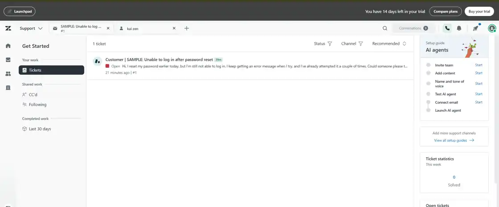
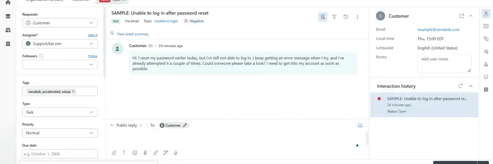
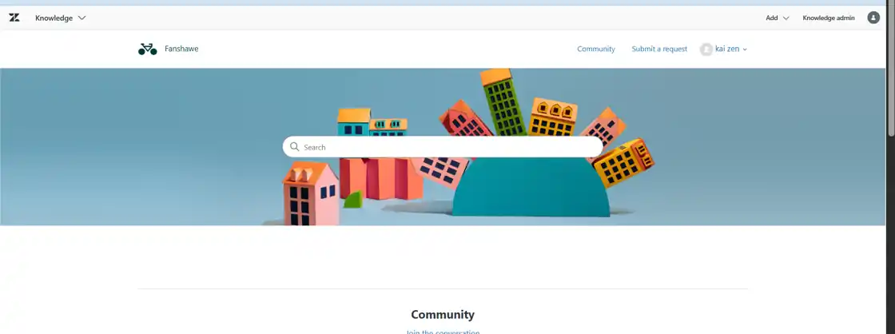
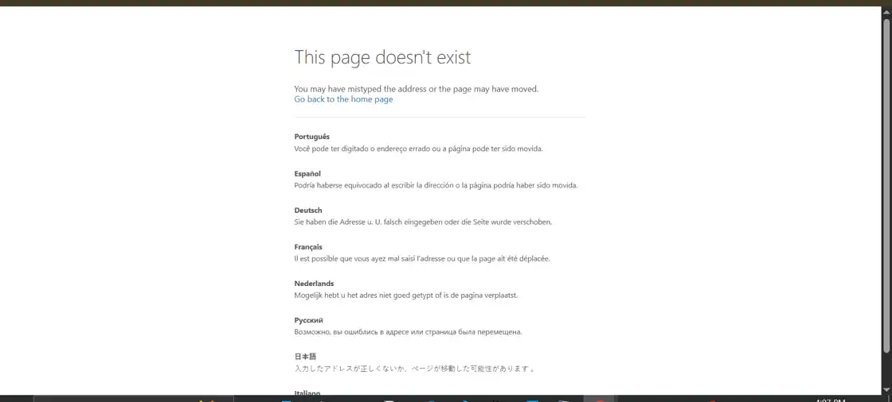
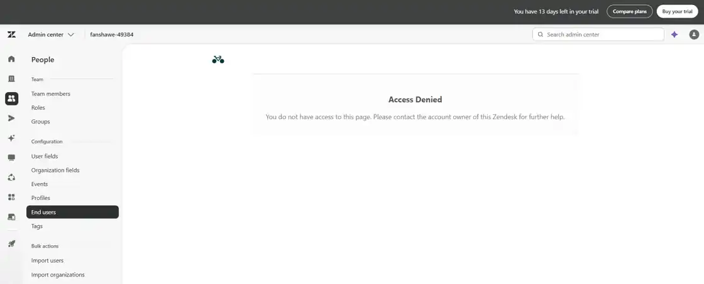
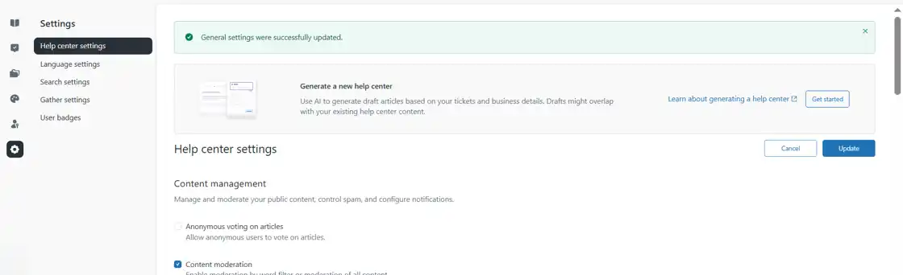
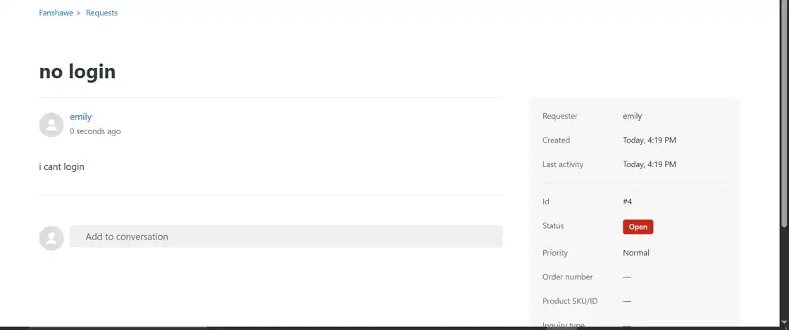
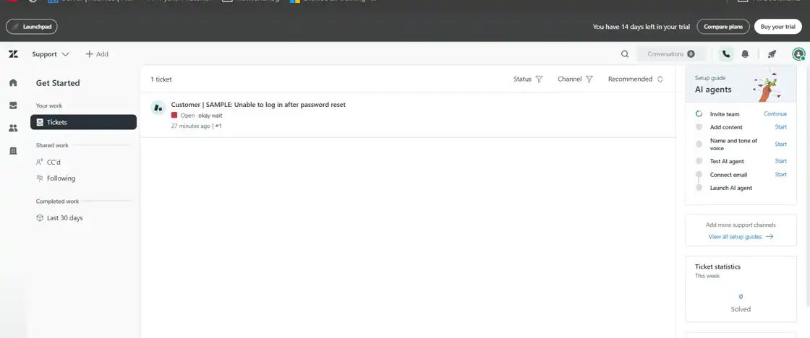
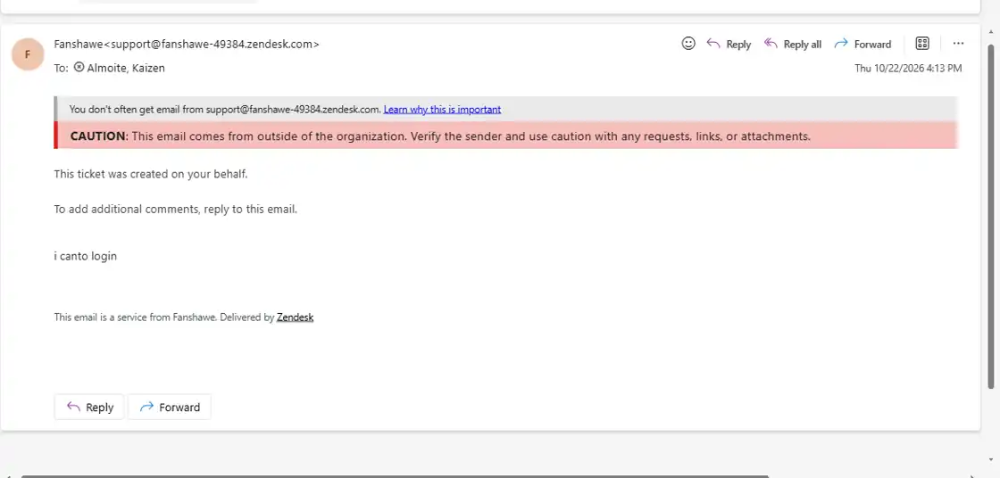

# Screenshot Evidence Index

Screenshots were taken from my own Zendesk trial during the practice lab on **October 22, 2026**. Browser chrome was cropped to reduce unnecessary account information. They are **evidence of UI observations**, not proof of the completion of unrelated configuration, troubleshooting, or resolution activities.

## 01 — Agent workspace

**What it shows:** Zendesk Support with a preloaded login sample ticket. The left navigation includes the personal Tickets view.

**What it proves:** I accessed the ticket-handling side of Zendesk and identified a sample ticket; it does **not** show Emily's ticket #4.

## 02 — Ticket details and fields

**What it shows:** Requester, group/assignee, tags, type, priority, ticket conversation, customer history, public reply composer, and submission/status control.

**What it proves:** I inspected the agent ticket detail interface and the major fields used to handle a request.

## 03 — Help Center preview

**What it shows:** Zendesk Knowledge, the sample Help Center and customer-facing navigation.

**What it proves:** I accessed the customer portal preview. Initial access as an administrator did not necessarily mean the portal was already available to customers.

## 04 — Initially unavailable request form

**What it shows:** The "This page doesn't exist" result when trying the customer request path earlier in setup.

**What it proves:** I encountered an initial portal/request-form access problem. It does **not** establish the root cause by itself.

## 05 — Restricted Admin Center settings

**What it shows:** An "Access Denied" message while visiting end-user settings.

**What it proves:** That specific Admin Center page was not available under the current session/permissions.

## 06 — Help Center settings updated

**What it shows:** Knowledge Help Center settings with a successful update banner after the activation steps.

**What it proves:** A Help Center configuration update succeeded; the subsequent end-user request in screenshot #7 is stronger evidence that the customer workflow was accessible.

## 07 — Ticket #4 submitted by Emily

**What it shows:** The end-user account **Emily** viewing request **#4**, subject **"no login"**, description **"i cant login"**, status **Open**, priority **Normal**.

**What it proves:** A separate test customer successfully submitted a Zendesk request and could view it.

## 08 — Agent's personal work list

**What it shows:** The agent's Your work → Tickets page listing only the sample ticket #1.

**What it proves:** Emily's #4 was not included in that personal queue at the time. The later observation that #4 was unassigned explains its absence from this filtered view, but the unassigned field itself is **not shown in the screenshot**.

## 09 — Notification for an earlier self-submitted ticket

**What it shows:** A ticket-created confirmation email with "This ticket was created on your behalf."

**What it proves:** An earlier request generated a requester notification when the same account was used on the customer side. This is **not** evidence that an agent successfully responded to Emily's ticket.

## Evidence limitations

- Ticket #4's agent-side **Assignee** field before/after taking ownership was not among the provided screenshots.
- No screenshot demonstrates a complete public reply → customer response → Solved interaction.
- No organization-specific SLA, macro, trigger, intelligent triage, or tag configuration was demonstrated in these images.
- Avoid conflating sample ticket **#1**, earlier self-submitted ticket **#3**, and Emily's ticket **#4**.
